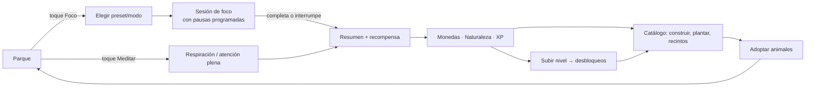

# 02 — Game Design Document

## Pilares
1. **El tiempo real construye el parque.** Ninguna acción dentro del juego genera recursos por sí sola; solo las sesiones de foco y meditación (y objetivos que dependen de ellas).
2. **Cozy, no compulsivo.** Sin timers de espera dentro del juego, sin energía, sin castigos por ausencia, sin rachas que se pierdan con penalización.
3. **Honestidad.** El juego mide tiempo con la app activa o en segundo plano; no afirma medir concentración.
4. **Dos toques al foco.** Desde el parque: `Foco` → preset → corre.

## Core loop

Loop corto (sesión): 15–90 min. Loop medio (día): objetivos diarios, 1–3 compras. Loop largo (semanas): niveles, expansiones del parque, colección de especies.

## Recursos
| Recurso | Clave | Fuente principal | Uso |
|---|---|---|---|
| Monedas | `coins` | Minutos de foco | Caminos, plantas, decoración, recintos, expansiones |
| Puntos de naturaleza | `nature` | Meditación (principal), foco (menor) | Recintos avanzados y animales |
| Experiencia | `xp` | Todo minuto recompensado | Niveles (no se gasta) |

## Economía (valores en `data/economy.json`; esta tabla es la referencia de diseño)

### Recompensa de foco
- Minutos efectivos = tiempo de reloj desde inicio − tiempo en pausa, limitado a la duración planificada.
- Sesión **completada**: `coins = floor(min × 2 × 1.2)`, `nature = floor(min × 0.1)`, `xp = floor(min × 1)`.
- Sesión **interrumpida**: mismos factores sobre los minutos efectivos, con multiplicador 0.5 y sin bonus de completado. Si los minutos efectivos son < 5, la recompensa es 0, pero la sesión se registra sin ningún mensaje negativo.
- Duración permitida: 5–180 min. Presets: 15, 25, 45, 50, 90.
- **Tope diario de bienestar** (por día local, suma de minutos de foco recompensables):
  - 0–240 min: multiplicador 1.0
  - 240–480 min: multiplicador 0.5
  - > 480 min: 0 (se registra; mensaje sugiriendo descanso)
  - Una sesión que cruza un umbral se reparte proporcionalmente entre tramos.
- Descansos programados: no dan recompensa ni la quitan.

### Recompensa de meditación
- `coins = floor(min × 1)`, `nature = floor(min × 2)`, `xp = floor(min × 1)`.
- Mínimo 60 s para recompensar; tope diario 60 min recompensables.
- Respiraciones cortas (1–2 min) cuentan; interrumpir no penaliza, se acredita lo hecho si ≥ 60 s.

### Ingreso de referencia por perfil
| Perfil | Foco/día | Meditación/día | Monedas/día | Naturaleza/día | XP/día |
|---|---|---|---|---|---|
| Ligero | 25 min | 3 min | ≈ 63 + obj. | ≈ 8 | ≈ 28 |
| Medio | 2 h | 5 min | ≈ 293 + obj. | ≈ 22 | ≈ 125 |
| Intenso | 8 h | 10 min | ≤ 874 (tope) | ≈ 56 | ≤ 370 |

### Niveles (XP acumulada para alcanzar el nivel)
| Nivel | 2 | 3 | 4 | 5 | 6 | 7 | 8 | 9 | 10 | 11 | 12 | 13 | 14 | 15 |
|---|---|---|---|---|---|---|---|---|---|---|---|---|---|---|
| XP | 100 | 250 | 450 | 700 | 1000 | 1400 | 1900 | 2500 | 3200 | 4000 | 5000 | 6200 | 7600 | 9200 |

Perfil medio llega a nivel 5 ≈ día 6, nivel 7 ≈ día 11, nivel 15 ≈ día 74.

### Catálogo
| id | Categoría | Tamaño | Costo | Nivel |
|---|---|---|---|---|
| path_dirt | path | 1×1 | 3 c | 1 |
| path_stone | path | 1×1 | 6 c | 2 |
| path_wood | path | 1×1 | 10 c | 4 |
| bush_flower | plant | 1×1 | 12 c | 1 |
| tree_oak | plant | 1×1 | 25 c | 1 |
| tree_pine | plant | 1×1 | 30 c | 2 |
| tree_cherry | plant | 1×1 | 60 c | 6 |
| flower_tulips | plant | 1×1 | 18 c | 3 |
| fern | plant | 1×1 | 8 c | 1 |
| hedge | plant | 1×1 | 10 c | 1 |
| potted_plant | plant | 1×1 | 15 c | 1 |
| sunflower | plant | 1×1 | 14 c | 2 |
| lavender | plant | 1×1 | 16 c | 2 |
| cactus | plant | 1×1 | 20 c | 3 |
| bamboo | plant | 1×1 | 28 c | 4 |
| palm_tree | plant | 1×1 | 45 c | 5 |
| sign_wood | decor | 1×1 | 20 c | 2 |
| rock_mossy | decor | 1×1 | 15 c | 2 |
| bench | decor | 1×1 | 40 c | 1 |
| lamp | decor | 1×1 | 50 c | 3 |
| fountain | decor | 2×2 | 300 c | 5 |
| pond | decor | 2×2 | 180 c | 4 |
| statue | decor | 1×1 | 500 c | 8 |
| enclosure_meadow | enclosure | 3×3, capacidad 3 | 200 c | 1 |
| enclosure_ice | enclosure | 3×3, capacidad 3 | 400 c + 20 n | 2 |
| enclosure_forest | enclosure | 3×3, capacidad 3 | 600 c + 40 n | 4 |
| enclosure_savanna | enclosure | 4×4, capacidad 2 | 1200 c + 80 n | 7 |
| lantern_premium | decor (premium) | 1×1 | 0 c + entitlement `premium` | 1 |

Quitar un objeto devuelve 50 % de las monedas (no la naturaleza). Mover es gratis.

### Expansiones del parque (mapa 24×24, área inicial 12×12 centrada)
| id | Área resultante | Costo | Nivel |
|---|---|---|---|
| expand_1 | 16×16 | 800 c | 3 |
| expand_2 | 20×20 | 2000 c | 6 |
| expand_3 | 24×24 | 4000 c | 10 |

### Especies
| id | Bioma | Costo | Nivel | Rasgo visual |
|---|---|---|---|---|
| rabbit | meadow | 50 c + 10 n | 1 | Orejas largas, salta corto |
| penguin | ice | 120 c + 25 n | 2 | Bamboleo lento |
| beaver | meadow | 150 c + 30 n | 3 | Cola plana, tranquilo |
| koala | forest | 250 c + 50 n | 5 | Dormilón, paso lento |
| elephant | savanna | 600 c + 120 n | 7 | Grande, paso lento |
| seal | ice | 200 c + 40 n | 4 | Se desliza, paso pesado |
| fox | forest | 320 c + 65 n | 6 | Cola con punta blanca, ágil |
| zebra | savanna | 800 c + 150 n | 9 | Rayada, trote medio |

Un animal se adopta dentro de un recinto de su bioma con capacidad libre. Los animales no se venden en MVP.

### Regalo inicial y objetivos
- Regalo inicial (tutorial, una vez, clave `starter_grant`): 300 c + 10 n. Alcanza para árbol + recinto pradera + conejo.
- **Objetivos diarios:** 3 por día elegidos de forma determinista por fecha (semilla = `YYYYMMDD`) del pool:
  | id | Condición | Recompensa |
  |---|---|---|
  | complete_1_session | 1 sesión completada | 30 c |
  | complete_2_sessions | 2 sesiones completadas | 50 c |
  | focus_50_minutes | 50 min de foco recompensable | 40 c + 5 n |
  | meditate_3_minutes | 3 min de meditación | 20 c + 5 n |
  | place_3_objects | colocar 3 objetos | 15 c |
  Si no se cumplen, simplemente cambian al día siguiente. Se reclaman una sola vez (clave `daily:<fecha>:<id>`).
- **Logros** (una vez cada uno): first_session (20 c), focus_10_hours (150 c), first_animal (30 n), all_species (todas las especies, 300 c), meditate_7_days (7 días distintos, no consecutivos; 50 n), level_5 (100 c).

### Anti-abuso (lo que el sistema garantiza y lo que no)
- **Garantiza:** cada sesión acredita como máximo una vez (idempotencia por `session_id`); nunca más minutos que los planificados; una sola sesión activa; dividir en muchas sesiones cortas no rinde más por minuto que una larga; el tope diario acota el ingreso máximo (≈ 874 c/día de foco).
- **Detecta:** reloj del sistema que retrocede (la sesión se cierra como interrumpida con los minutos medidos hasta el último instante válido).
- **No garantiza:** que el usuario esté concentrado; adelantar el reloj del dispositivo offline. Se mitiga con el tope diario y, cuando el servidor tenga autoridad, con validación de timestamps del servidor.

## Progresión y desbloqueos
- Nivel 1: pradera, conejo, caminos de tierra, roble, arbusto, helecho, seto, maceta, banco.
- Nivel 2: hielo + pingüino, piedra, pino, girasol, lavanda, cartel, roca con musgo.
- Nivel 3: castor, farol, tulipanes, cactus, expansión 1.
- Nivel 4: bosque, camino de madera, foca, bambú, estanque. Nivel 5: koala, palmera, fuente.
- Nivel 6: cerezo, zorro, expansión 2. Nivel 7: sabana + elefante. Nivel 8: estatua. Nivel 9: jirafa. Nivel 10: expansión 3.
- Al subir de nivel: tarjeta "Nuevo en el catálogo" con los ítems desbloqueados.

## Meditación (bienestar general)
| id | Tipo | Patrón | Duraciones |
|---|---|---|---|
| box | Respiración caja | inhala 4 · sostén 4 · exhala 4 · sostén 4 | 1, 2, 5 min |
| relax_478 | Respiración 4-7-8 | inhala 4 · sostén 7 · exhala 8 | 1, 2, 4 min |
| coherent | Respiración coherente | inhala 5 · exhala 5 | 2, 5, 10 min |
| mindful | Atención plena guiada | textos breves cada 30–60 s | 3, 5, 10 min |
| pause | Pausa consciente | 1 min, 3 respiraciones + consigna | 1 min |

Texto legal visible en la pantalla: "Ejercicios de bienestar general. No sustituyen atención médica ni psicológica."
Sin voz grabada en MVP; la guía es visual (círculo que se expande/contrae) + vibración suave opcional en cada cambio de fase.

## Dirección de arte
- **Una frase:** "Diorama de jardín al atardecer": isométrico 2:1, formas redondeadas, paleta cálida y desaturada, sombras suaves de contacto, sin contornos negros duros.
- **Paleta base:** pasto `#8CC084`, pasto oscuro `#6FA56A`, tierra `#C9A27E`, agua `#7EC8E3`, hielo `#DDEFF6`, arena sabana `#E6C88A`, bosque `#4F8A5B`, madera `#A9744F`, UI crema `#FFF8EC`, UI tinta `#3D3A35`, acento coral `#F08A6C`, acento menta `#7FD1B9`.
- **Proyección:** tile isométrico 128×64 px (2:1). Objetos 1×1 en lienzo 128×160; 2×2 en 256×256; 3×3 en 384×320; 4×4 en 512×384. Animales en lienzo 96×96 (elefante 160×128). Pivote: centro de la base del rombo (offset definido en `data/catalog.json`).
- **Resolución:** viewport base 720×1280; arte a 1× de esa base, exportado a 2× (`@2x`) para pantallas densas; Godot escala con `canvas_items`.
- **Capas (z / y-sort):** 0 terreno (TileMapLayer) · 1 caminos (TileMapLayer) · 2 overlay de cuadrícula/fantasma · 3 objetos + animales (un `Node2D` con `y_sort_enabled`) · 4 efectos/partículas · UI en `CanvasLayer` aparte.
- **Atlas:** un atlas por categoría (`terrain_atlas.png`, `paths_atlas.png`, `objects_<categoria>.png`, `animals_<especie>.png` como spritesheet por animación), máximo 2048×2048, con margen de 2 px para evitar sangrado.
- **Animaciones animales:** `idle` (4–6 frames, 6 fps), `walk_ne/nw/se/sw` (6 frames, 10 fps); en MVP placeholder con squash/bob por código.
- **Convención de nombres:** `assets/<categoria>/<id>[_<variante>][_<anim>].png`, minúsculas y `snake_case`, id idéntico al de `data/catalog.json`/`data/species.json`. Ej.: `assets/animals/koala_walk_se.png`.
- **Placeholders:** generados por código en `ArtRegistry` (rombos coloreados, árboles de círculos, animales de elipses con orejas) usando la paleta. Si existe `assets/...<id>.png`, se usa ese archivo; si no, el placeholder. Reemplazar arte = soltar PNGs con el nombre correcto, cero cambios de lógica.
- **UI:** tarjetas crema con radio 20, sombras suaves, íconos redondeados, tipografía redondeada (Nunito o similar con licencia OFL, a incluir en hito de pulido; MVP usa la fuente por defecto de Godot).

## Audio
- Buses: `Master` → `Music`, `Ambient`, `SFX`; volúmenes independientes en Perfil.
- Ambientes MVP generados por síntesis (`AudioStreamGenerator`): ruido marrón, lluvia (ruido filtrado con gotas), bosque (ruido rosa + pájaros sintéticos simples). Archivos reales los reemplazan luego con el mismo id.
- Campana suave al terminar sesión (síntesis), configurable.

## Monetización
- Gratis: todo el loop, las 5 especies, 4 biomas, estadísticas básicas.
- Premium (pago único, precio a definir): bioma cosmético extra (post-MVP), ambientes adicionales, estadísticas extendidas (historial completo, exportar CSV), decoraciones exclusivas.
- Packs cosméticos: decoraciones sin efecto económico.
- Prohibido: vender monedas, naturaleza, XP, saltar sesiones o desbloquear niveles; anuncios durante el foco (no hay anuncios en MVP).
