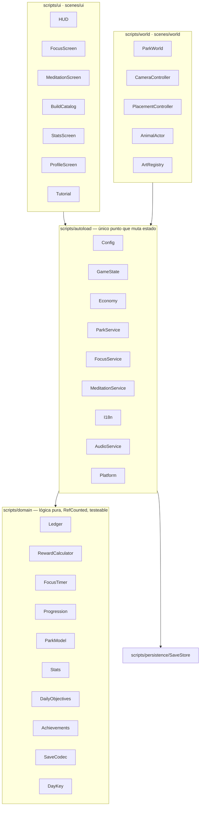

# 03 — Arquitectura técnica (TRD)

## Stack
| Capa | Elección | Por qué | Alternativa descartada |
|---|---|---|---|
| Motor | Godot 4.7.2 stable | Último estable; export nativo Android/iOS; 2D isométrico maduro | Unity (licencia, peso), Flutter+Flame (iso menos maduro) |
| Lenguaje | GDScript tipado (`untyped_declaration` = warning) | Pedido explícito; iteración rápida | C# (no exporta a iOS de forma estable en todos los casos, binario mayor) |
| Renderer | Compatibility (OpenGL ES 3 / WebGL2) | Gama baja móvil y batería | Mobile (Vulkan) — se puede cambiar en `project.godot` |
| Terreno | `TileMapLayer` isométrico (diamond down, 128×64) | API actual (TileMap está deprecado desde 4.3) | Sprites sueltos (más nodos, más draw calls) |
| Objetos/animales | `Node2D` con `y_sort_enabled` | Orden de profundidad correcto con objetos multi-celda | Tiles de objetos (no permite animación libre) |
| Tests | Runner propio headless (`tests/run_tests.gd`) | Cero dependencias externas; corre en CI | GUT (plugin de terceros; se puede adoptar luego) |
| Persistencia local | JSON en `user://` con escritura atómica + checksum SHA-256 + backup | Simple, inspeccionable, migrable | SQLite (requiere GDExtension de terceros) |
| Sync remoto | Supabase vía REST (PostgREST) — **post-slice, opcional** | Postgres + RLS + Auth | Firebase (SDK no oficial en Godot) |
| IAP | Interfaz `StoreService` + backend mock — **plugins sin confirmar** | Ver R4 | — |
| Notificaciones | Interfaz `NotificationBackend` + backend nulo — **plugin sin confirmar** | Ver R3 | — |

### Integraciones NO confirmadas (no se instalan sin aprobación)
| Integración | Opción candidata | Estado | Qué falta |
|---|---|---|---|
| Google Play Billing | `godotengine/godot-google-play-billing` (oficial, AAR) | Sin verificar compatibilidad con 4.7 | Probar build Android; cuenta Google Play (USD 25) |
| App Store IAP | `godotengine/godot-ios-plugins` → `inappstore` | Sin verificar con 4.7 / StoreKit 2 | Mac + Xcode; cuenta Apple Developer (USD 99/año) |
| Notificaciones locales | Plugin Android propio (WorkManager/AlarmManager) e iOS (`UNUserNotificationCenter`) | Sin elegir | Decidir plugin comunitario vs. propio |
| Supabase | REST directo con `HTTPRequest` | Diseñado (ver 05), sin proyecto creado | Crear proyecto free tier (confirmar) |

## Capas

Reglas: el dominio no usa `Node`, `get_tree()`, `Time` ni archivos (recibe `now: int` y diccionarios de config). UI y mundo solo leen estado y llaman métodos de servicios; reaccionan a señales.

## Estructura de carpetas
```
project.godot
data/            economy.json · catalog.json · species.json · meditations.json · objectives.json
locale/          en.json · es.json            (clave → texto)
assets/          README.md (convención); arte final se suelta acá — vacío en MVP
scenes/
  main.tscn
  world/park_world.tscn · world/animal_actor.tscn
  ui/hud.tscn · ui/focus_screen.tscn · ui/meditation_screen.tscn · ui/build_catalog.tscn
     ui/stats_screen.tscn · ui/profile_screen.tscn · ui/tutorial_overlay.tscn
scripts/
  domain/        clock.gd · day_key.gd · ledger.gd · reward_calculator.gd · focus_timer.gd · progression.gd
                 park_model.gd · stats.gd · daily_objectives.gd · achievements.gd · save_codec.gd · config_loader.gd
  persistence/   save_store.gd
  autoload/      config.gd · game_state.gd · economy.gd · park_service.gd · focus_service.gd
                 meditation_service.gd · i18n.gd · audio_service.gd · platform.gd
  platform/      store_service.gd · mock_store.gd · notification_backend.gd · null_notification_backend.gd
  world/         iso_grid.gd · art_registry.gd · park_world.gd · camera_controller.gd · placement_controller.gd
                 placed_object.gd · animal_actor.gd
  ui/            main.gd · ui_kit.gd · theme_factory.gd · hud.gd · focus_screen.gd · meditation_screen.gd
                 build_catalog.gd · stats_screen.gd · profile_screen.gd · tutorial_overlay.gd · toast.gd
tests/
  run_tests.gd · test_case.gd · helpers/fake_clock.gd · unit/test_*.gd · integration/test_*.gd
docs/
```

## Árbol de escenas
```
Main (Node, scripts/ui/main.gd)                         scenes/main.tscn
├─ ParkWorld (Node2D, park_world.gd)                     scenes/world/park_world.tscn
│  ├─ Ground (TileMapLayer)          terreno + zona bloqueada
│  ├─ Paths (TileMapLayer)           caminos (visual; ocupación en ParkModel)
│  ├─ GridOverlay (Node2D)           dibuja celdas en modo construcción
│  ├─ Entities (Node2D, y_sort)      PlacedObject (Sprite2D) + AnimalActor
│  ├─ Ghost (Sprite2D)               previsualización de colocación
│  ├─ PlacementController (Node)
│  └─ Camera2D (camera_controller.gd)
└─ UI (CanvasLayer, layer 10)
   ├─ HUD (Control)                  recursos, nivel, barra inferior, botón Foco grande
   ├─ ScreenHost (Control)           pantallas a pantalla completa, una a la vez
   ├─ TutorialOverlay (Control)
   └─ Toasts (VBoxContainer)
```

## Contratos (firmas obligatorias)

### Dominio (`class_name`, extienden `RefCounted`)
```gdscript
class_name Clock                 # now() -> int (unix s); tz_offset_seconds() -> int
class_name FakeClock extends Clock   # (tests/helpers) var t: int; var tz: int; advance(seconds: int)
class_name DayKey                # static of(unix: int, tz_offset: int) -> String  "YYYY-MM-DD"
                                 # static add_days(day: String, n: int) -> String
class_name ConfigLoader          # static load_json(path: String) -> Variant   (assert on parse error)

class_name Ledger
  var balances: Dictionary       # {"coins": int, "nature": int, "xp": int}
  func apply(key: String, delta: Dictionary, reason: String, at: int) -> Dictionary
      # {"ok": bool, "duplicate": bool, "error": String}; all-or-nothing; error "insufficient_funds"
      # duplicate key -> {"ok": true, "duplicate": true} and no change; xp delta may not be negative
  func can_afford(cost: Dictionary) -> bool
  func get_balance(resource: String) -> int
  func has_key(key: String) -> bool
  func to_dict() -> Dictionary;  static func from_dict(d: Dictionary) -> Ledger
  # transaction log capped at 500 entries; applied keys kept forever

class_name RewardCalculator
  static func focus_reward(cfg: Dictionary, effective_min: float, completed: bool, rewarded_today_min: float) -> Dictionary
      # {"coins": int, "nature": int, "xp": int, "counted_min": float}  counted_min adds to daily cap usage
  static func meditation_reward(cfg: Dictionary, seconds: int, rewarded_today_min: float) -> Dictionary
  static func max_daily_focus_coins(cfg: Dictionary) -> int

class_name FocusTimer
  enum State { IDLE, FOCUS, PAUSED, BREAK, FINISHED }
  var state: State
  func start(now: int, session_id: String, minutes: int, mode: String, cycles: int = 1, break_min: int = 0) -> void
  func pause(now: int) -> void
  func resume(now: int) -> void
  func interrupt(now: int) -> Dictionary          # focus record or {} if not in FOCUS/PAUSED
  func skip_break(now: int) -> void
  func tick(now: int) -> Array                    # reconciles; returns events in order:
      # {"type": "focus_completed", "record": Dictionary}
      # {"type": "break_started"} · {"type": "break_completed"} · {"type": "plan_finished"}
      # {"type": "clock_anomaly", "record": Dictionary}   (clock went back > 120 s: interrupted at last_seen)
  func remaining_s(now: int) -> int
  func elapsed_focus_s(now: int) -> int
  func to_dict() -> Dictionary;  static func from_dict(d: Dictionary) -> FocusTimer
  # record: {"id": "<session_id>#<cycle>", "mode", "planned_min": int, "effective_min": float,
  #          "status": "completed"|"interrupted", "started_at": int, "ended_at": int, "cycle": int}
  # completion is computed from timestamps (ended_at = start + planned + paused), never from frame time

class_name Progression
  static func level_for_xp(cfg: Dictionary, xp: int) -> int
  static func xp_for_level(cfg: Dictionary, level: int) -> int
  static func newly_unlocked(catalog: Dictionary, species: Dictionary, old_level: int, new_level: int) -> Array[String]

class_name ParkModel
  var map_size: int; var unlocked_size: int
  var objects: Dictionary        # uid -> {"uid", "item_id", "cell": Vector2i, "size": Vector2i}
  var animals: Dictionary        # uid -> {"uid", "species_id", "enclosure_uid"}
  func is_cell_unlocked(cell: Vector2i) -> bool  # centered square of unlocked_size
  func can_place(size: Vector2i, cell: Vector2i, ignore_uid: String = "") -> bool
  func place(uid: String, item_id: String, size: Vector2i, cell: Vector2i) -> bool
  func move(uid: String, cell: Vector2i) -> bool
  func remove(uid: String) -> Dictionary         # removed entry or {}; refuses enclosure with animals
  func object_at(cell: Vector2i) -> String
  func animals_in(enclosure_uid: String) -> Array
  func add_animal(uid: String, species_id: String, enclosure_uid: String) -> void
  func to_dict() -> Dictionary;  static func from_dict(d: Dictionary) -> ParkModel   # Vector2i as [x, y]

class_name Stats
  static func daily_focus_minutes(sessions: Array, last_day: String, days: int, tz: int) -> Array  # [{"day", "minutes"}]
  static func summary(sessions: Array, from_day: String, to_day: String, tz: int) -> Dictionary
      # {"total_min", "completed", "interrupted", "by_mode": {mode: minutes}}

class_name DailyObjectives
  static func pick(pool: Array, day: String, count: int = 3) -> Array[String]   # deterministic
  static func progress(def: Dictionary, metrics: Dictionary) -> Dictionary      # {"current", "target", "done"}

class_name Achievements
  static func evaluate(defs: Array, totals: Dictionary, earned: Dictionary) -> Array[String]

class_name SaveCodec
  const SCHEMA_VERSION := 1
  static func encode(data: Dictionary, at: int) -> String     # {"schema_version","saved_at","checksum","data"}
  static func decode(text: String) -> Dictionary              # {"ok", "data", "error"}; checks checksum; migrates
```

### Persistencia
```gdscript
class_name SaveStore extends RefCounted
  func _init(dir: String = "user://")
  func save(data: Dictionary, at: int) -> bool
      # 1) write save.json.tmp  2) re-read + decode OK  3) copy save.json -> save.bak  4) rename tmp -> save.json
  func load_latest() -> Dictionary   # {"ok", "data", "source": "main"|"backup"|"none"}
```

### Autoloads (orden en `project.godot`)
| Autoload | Responsabilidad | API pública | Señales |
|---|---|---|---|
| `Config` | Carga `data/*.json` | `economy`, `catalog` (id→item), `species`, `meditations`, `objectives`; `item(id)`, `items_in(category)` | — |
| `I18n` | Carga `locale/*.json` como `Translation` | `set_locale(code)`, `locale()` ; se usa `tr("key")` | `locale_changed` |
| `GameState` | Dueño del estado y del guardado | `clock: Clock`, `ledger`, `park`, `timer`, `focus_sessions`, `meditation_sessions`, `progress`, `settings`; `load_or_new()`, `save_now()`, `mark_dirty()` (guardado diferido 0.5 s), `new_uid(prefix)`, `now()`, `today()`, `debug_offset_s` (solo debug), `reset_for_tests(dir, clock)` | `state_loaded`, `settings_changed` |
| `Economy` | Única puerta al `Ledger` | `grant(key, delta, reason) -> Dictionary`, `spend(key, cost, reason) -> Dictionary`, `balance(res)`, `level()`, `day_metrics(day)`, `objectives_today() -> Array`, `claim_objective(id) -> Dictionary`, `check_achievements()` | `resources_changed(balances)`, `level_up(level, unlocked)`, `objectives_changed`, `achievement_earned(id)` |
| `ParkService` | Compras y cambios del parque | `buy_and_place(item_id, cell) -> Dictionary`, `move_object(uid, cell) -> bool`, `remove_object(uid) -> Dictionary`, `adopt(species_id, enclosure_uid) -> Dictionary`, `buy_expansion(id) -> Dictionary`, `enclosures_for(species_id) -> Array` | `object_placed(uid)`, `object_moved(uid)`, `object_removed(uid)`, `animal_adopted(uid)`, `park_expanded(size)` |
| `FocusService` | Sesión activa, reconciliación, recompensas | `start(minutes, mode, cycles, break_min)`, `pause()`, `resume()`, `interrupt()`, `skip_break()`, `state()`, `remaining_s()`, `is_active()` | `started`, `ticked(remaining_s)`, `phase_changed(state)`, `focus_finished(record, reward)` |
| `MeditationService` | Ejercicios y recompensa | `start(exercise_id, minutes)`, `finish(completed: bool) -> Dictionary`, `phase_at(elapsed_s) -> Dictionary` | `finished(record, reward)` |
| `AudioService` | Buses, ambientes, sfx | `set_volume(bus, linear)`, `play_ambient(id)`, `stop_ambient()`, `play_sfx(id)` | — |
| `Platform` | Háptica, notificaciones, tienda | `haptic(ms)`, `schedule_notification(id, in_s, title, body)`, `cancel_notification(id)`, `store: StoreService` | — |

Claves idempotentes de transacciones: `focus:<record.id>`, `meditation:<id>`, `buy:<uid>`, `refund:<uid>`, `adopt:<uid>`, `expand:<id>`, `starter_grant`, `daily:<YYYY-MM-DD>:<id>`, `ach:<id>`.

## Temporizador y segundo plano
1. `start` persiste de inmediato (`save_now`) `started_at`, duración y plan.
2. `FocusService` usa un `Timer` de 1 s solo para refrescar la UI; el tiempo se calcula siempre como `now - started_at - paused_total`.
3. `NOTIFICATION_APPLICATION_PAUSED` / `WM_CLOSE_REQUEST`: `save_now()` y programar notificación de fin (si están activas).
4. `NOTIFICATION_APPLICATION_RESUMED` / arranque: `timer.tick(now)` procesa todas las transiciones atrasadas (varios ciclos y descansos) en orden y acredita cada ciclo una vez.
5. Acreditación + registro de sesión + guardado ocurren en una misma llamada → un único archivo escrito atómicamente = transacción.
6. Reloj hacia atrás > 120 s respecto del último `last_seen`: evento `clock_anomaly`, la sesión se cierra como interrumpida en `last_seen`.

## Rendimiento y batería
- Pantallas a pantalla completa (foco, meditación, estadísticas) ocultan `ParkWorld` y le ponen `process_mode = DISABLED`; `OS.low_processor_usage_mode = true` y `Engine.max_fps = 30` mientras están abiertas.
- Animales: `AnimalActor` usa tweens, no `_process`. Máximo 30 animales en MVP.
- Placeholders se generan una vez y se cachean en `ArtRegistry`.

## Calidad
- `project.godot` activa warnings de GDScript tipado como advertencia.
- Tests: `godot --headless --import` (genera caché de clases) y luego `godot --headless -s res://tests/run_tests.gd` → exit 0 si todo pasa.
- CI (GitHub Actions, hito 6): descarga Godot 4.7.2 headless, corre import + tests + smoke boot.

## Observabilidad
- `push_error`/`push_warning` para fallos de carga/guardado; log local rotativo post-MVP. Sin analítica de terceros en MVP.

## Contratos adicionales (formato de datos, resultados, mundo, textos)

### Formato de `data/*.json`
```jsonc
// economy.json
{"focus": {"coins_per_min": 2, "nature_per_min": 0.1, "xp_per_min": 1, "completion_bonus": 0.2,
           "interrupted_multiplier": 0.5, "min_reward_minutes": 5, "min_minutes": 5, "max_minutes": 180,
           "presets": [15, 25, 45, 50, 90], "break_options": [5, 10, 15], "max_cycles": 4,
           "daily_tiers": [{"up_to_min": 240, "multiplier": 1.0}, {"up_to_min": 480, "multiplier": 0.5}]},
 "meditation": {"coins_per_min": 1, "nature_per_min": 2, "xp_per_min": 1, "min_seconds": 60, "daily_cap_min": 60},
 "levels": {"xp_thresholds": [0, 100, 250, 450, 700, 1000, 1400, 1900, 2500, 3200, 4000, 5000, 6200, 7600, 9200]},
 "refund_ratio": 0.5, "starter_grant": {"coins": 300, "nature": 10},
 "park": {"map_size": 24, "initial_unlocked": 12}, "modes": ["study", "work", "reading", "project"]}
// catalog.json
{"items": [{"id": "tree_oak", "category": "path|plant|decor|enclosure", "size": [1, 1],
            "cost": {"coins": 25, "nature": 0}, "unlock_level": 1,
            "biome": "meadow", "capacity": 3,          // only enclosures
            "premium": false}],
 "expansions": [{"id": "expand_1", "size": 16, "cost": {"coins": 800}, "unlock_level": 3}]}
// species.json
{"species": [{"id": "rabbit", "biome": "meadow", "cost": {"coins": 50, "nature": 10}, "unlock_level": 1,
              "speed": 0.8, "scale": 0.7, "color": "#E8DCCB"}]}
// meditations.json
{"exercises": [{"id": "box", "kind": "breath", "durations": [1, 2, 5],
                "phases": [{"name": "inhale", "seconds": 4}, {"name": "hold", "seconds": 4},
                           {"name": "exhale", "seconds": 4}, {"name": "hold", "seconds": 4}]},
               {"id": "mindful", "kind": "guided", "durations": [3, 5, 10], "prompt_every_s": 45,
                "prompts": ["med.mindful.p1", "med.mindful.p2"]}]}
// objectives.json
{"daily_count": 3,
 "daily_pool": [{"id": "complete_1_session", "metric": "sessions_completed", "target": 1, "reward": {"coins": 30}}],
 "achievements": [{"id": "first_session", "metric": "sessions_completed_total", "target": 1, "reward": {"coins": 20}}]}
```
Métricas diarias: `sessions_completed`, `focus_minutes`, `meditation_minutes`, `objects_placed`.
Métricas totales: `sessions_completed_total`, `focus_minutes_total`, `animals_total`, `species_distinct`, `meditation_days_distinct`, `level`.
`Config.catalog` y `Config.species` son `Dictionary` id → definición; `Config.expansions` es `Array`.

### Resultados de servicios
Toda operación que puede fallar devuelve `{"ok": bool, "error": String, ...}`. Códigos: `insufficient_funds`, `locked_level`, `invalid_cell`, `no_enclosure`, `enclosure_full`, `enclosure_not_empty`, `premium_required`, `already_owned`, `already_claimed`, `not_done`, `session_active`. La UI muestra `tr("error." + code)`.

### API de `ParkWorld` (scenes/world/park_world.tscn, raíz `Node2D`, script `park_world.gd`)
```gdscript
signal object_tapped(uid: String)                       # tap on placed object outside placement
signal placement_changed(active: bool, valid: bool)     # ghost state for UI confirm button
func set_active(active: bool) -> void                   # false: hide + PROCESS_MODE_DISABLED
func begin_placement(item_id: String) -> void
func begin_move(uid: String) -> void
func begin_adopt_target(species_id: String) -> void     # highlights valid enclosures; tap one adopts via ParkService
func confirm_placement() -> Dictionary                  # calls ParkService; returns its result
func cancel_placement() -> void
func focus_cell(cell: Vector2i) -> void                 # camera tween
```
Grid ↔ mundo: `TileMapLayer` isométrico, `tile_size = Vector2i(128, 64)`, layout diamond down; el origen de un objeto es su celda de menor (x, y); su posición en pantalla es el centro promedio de su huella.

### `GameState` extras
`set_setting(key: String, value: Variant)` guarda y emite `settings_changed(key)`. `now()` = `clock.now() + debug_offset_s`. `today()` = `DayKey.of(now(), clock.tz_offset_seconds())`.
`FocusService` reconcilia al cargar (diferido) y al volver de segundo plano; los resúmenes que la UI todavía no mostró se guardan en `FocusService.pending_summaries: Array` (`{"record", "reward"}`) y la UI los consume con `take_pending_summaries() -> Array`.

### Textos (`locale/en.json`, `locale/es.json`: objeto plano clave → texto)
Prefijos: `ui.*`, `hud.*`, `focus.*`, `med.*`, `build.*`, `stats.*`, `profile.*`, `tut.*`, `error.*`, `item.<id>`, `species.<id>`, `mode.<id>`, `med.<id>.name`, `obj.<id>`, `ach.<id>`, `cat.<category>`, `biome.<id>`.
