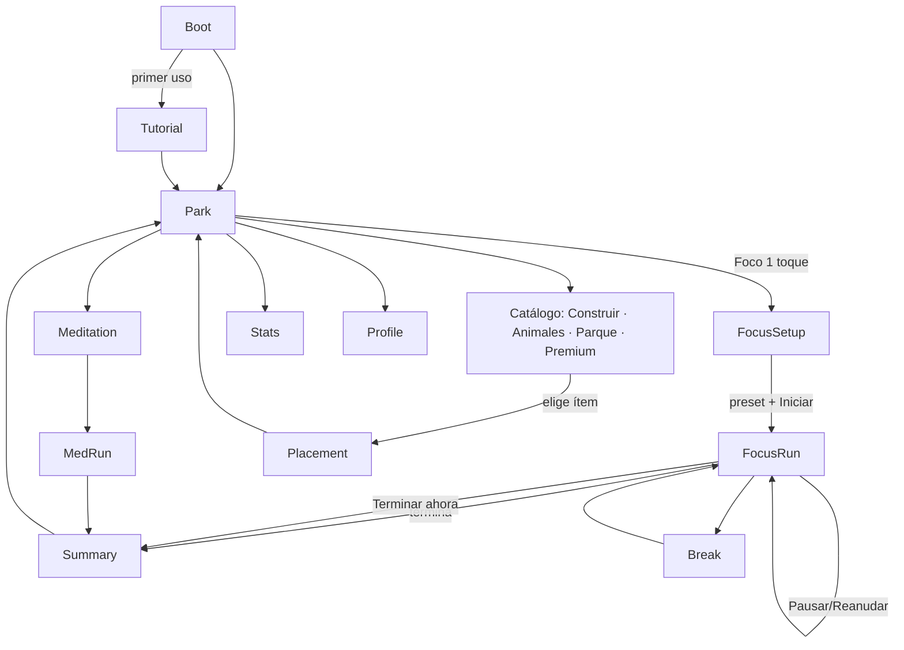

# 04 — UX y flujo de pantallas

## Mapa

## Pantallas
| Pantalla | Propósito | Contenido | Estados |
|---|---|---|---|
| Parque (HUD) | Inicio | Barra superior: monedas, naturaleza, nivel + barra XP. Botón circular grande **Foco** abajo al centro; a los lados Meditar, Construir, Estadísticas, Perfil. Tarjeta compacta de objetivos diarios. | Sesión activa: el botón Foco muestra el tiempo restante y vuelve a la sesión. |
| Configurar foco | Iniciar rápido | Chips de presets (último usado preseleccionado), "Personalizada" con stepper 5–180, chips de modo, ciclos 1–4 y descanso 5/10/15, ambiente. Botón **Iniciar**. | Desde el parque: Foco → Iniciar = 2 toques. |
| Foco en curso | Mostrar tiempo | Anillo de progreso, tiempo restante grande, modo, ciclo N/M, Pausar, Terminar ahora (confirma sin culpa: "Guardamos lo que hiciste"). | Pausada, descanso (color menta), finalizada. |
| Resumen | Recompensa | Minutos, recursos ganados con animación de conteo, mensaje amable; si se superó el tope diario: sugerencia de descanso. | Interrumpida: "Cada minuto cuenta" (sin rojo). |
| Meditación | Elegir ejercicio | Tarjetas de ejercicio, duración, aviso de bienestar general. | — |
| Meditación en curso | Guía | Círculo que crece/encoge según fase, texto de fase ("Inhala"), contador, Terminar. Vibración suave opcional en cambios de fase. | Reduce motion: el círculo cambia de opacidad en vez de tamaño. |
| Catálogo | Comprar | Pestañas Construir (por categoría), Animales, Parque (expansiones), Premium. Tarjeta: nombre, costo, nivel requerido (candado). | Sin fondos: botón deshabilitado con motivo. |
| Colocación | Ubicar | Fantasma sigue al dedo (snap a celda), verde ✓ / rojo ✗, botones Confirmar, Rotar (post-MVP), Cancelar. Tocar un objeto existente fuera de este modo: Mover / Quitar (+50 %). | Celda bloqueada: ✗ y texto. |
| Estadísticas | Progreso | Barras de 7 días, total semana, completadas/interrumpidas, por modo, minutos de meditación. | Vacío: "Tu primera sesión aparecerá acá". |
| Perfil | Ajustes y evolución | Nivel, colección de especies (5 siluetas), objetos colocados, idioma, volúmenes (General, Música, Ambiente, Efectos), vibración, reducir movimiento, tamaño de texto, recordatorios, restaurar compras, créditos. Debug: avanzar reloj 5 min. | — |

## Flujos clave
1. **Primer uso:** Bienvenida → "Tu parque crece con tus sesiones" → opción A "Probar 15 min" / opción B "Explorar primero" (ambas reciben regalo inicial) → abrir Catálogo (resalta botón) → plantar roble → construir recinto pradera → adoptar conejo → fin.
2. **Usuario recurrente:** abrir app → Foco → Iniciar (preset recordado) → bloquear pantalla → notificación al terminar → abrir → Resumen → Parque.
3. **Volver tras cerrar la app:** arranque → reconciliación → si terminó, Resumen se muestra una vez.

## Accesibilidad
- Botones ≥ 48×48 dp, separación ≥ 8 dp. Escala de texto 100/125/150 % aplicada al tema.
- Contraste AA: tinta `#3D3A35` sobre crema `#FFF8EC` (≈ 10:1); botón coral con texto tinta.
- Validez de colocación con ícono además de color. Sin información solo por color en gráficos (valores escritos).
- Reducir movimiento: sin rebotes de animales, transiciones por fundido.
- Todas las cadenas pasan por `tr()`; ES y EN completos.
