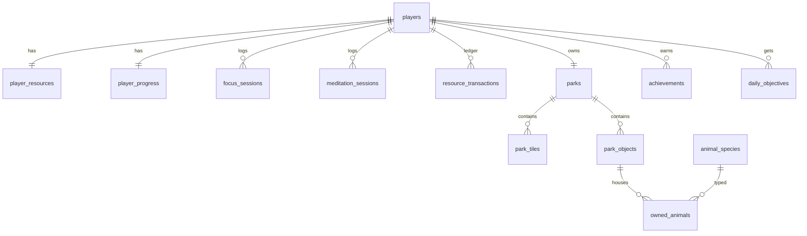

# 05 — Esquema de datos y persistencia

## Estrategia
- **Local primero.** La fuente de verdad del MVP es `user://save.json`. Funciona offline siempre.
- **Escritura atómica:** `save.json.tmp` → verificación (re-lectura + checksum) → `save.json` actual pasa a `save.bak` → rename del tmp. Si `save.json` está corrupto al cargar, se usa `save.bak`; si ambos fallan, partida nueva y el archivo dañado se renombra a `save.corrupt.<unix>.json` (nunca se borra).
- **Transacciones idempotentes:** cada cambio de recursos lleva una clave única (ver 03). El `Ledger` guarda las claves aplicadas; repetir una clave no cambia nada.
- **Versionado:** `schema_version` en el sobre; `SaveCodec.decode` migra paso a paso (`_migrate_1_to_2`, …).
- **Sync:** Cloudflare Worker + D1 (`server/`). Hoy replica `players`, `player_resources` y `resource_transactions`; el cliente sube `resource_transactions` por clave idempotente (`unique(player_id, idem_key)`) y el servidor recalcula saldos. Conflictos: el servidor gana en recursos; el parque usa last-write-wins por objeto con `updated_at`.

## Archivo local (`save.json`)
```json
{
  "schema_version": 1,
  "saved_at": 1763190000,
  "checksum": "sha256 del JSON canónico de data",
  "data": {
    "player":   {"id": "p_…", "created_at": 1763190000},
    "resources":{"balances": {"coins": 0, "nature": 0, "xp": 0},
                 "applied_keys": {"starter_grant": 1763190000},
                 "log": [{"key": "starter_grant", "delta": {"coins": 300}, "reason": "tutorial", "at": 1763190000}]},
    "park":     {"map_size": 24, "unlocked_size": 12,
                 "objects": {"o_1": {"uid": "o_1", "item_id": "tree_oak", "cell": [11, 12], "size": [1, 1]}},
                 "animals": {"a_1": {"uid": "a_1", "species_id": "rabbit", "enclosure_uid": "o_2"}}},
    "focus_active": null,
    "focus_sessions": [{"id": "s_…#1", "mode": "study", "planned_min": 25, "effective_min": 25.0,
                        "status": "completed", "started_at": 0, "ended_at": 0, "cycle": 1}],
    "meditation_sessions": [{"id": "m_…", "exercise": "box", "planned_min": 2, "seconds": 120,
                             "status": "completed", "started_at": 0, "ended_at": 0}],
    "progress": {"tutorial_step": 0, "tutorial_done": false, "achievements": {}, "daily_claimed": {},
                 "objects_placed_by_day": {}, "entitlements": []},
    "settings": {"locale": "", "vol_master": 1.0, "vol_music": 0.7, "vol_ambient": 0.7, "vol_sfx": 0.8,
                 "vibration": true, "reduce_motion": false, "text_scale": 1.0,
                 "reminders_enabled": false, "reminder_hour": 9, "ambient_id": "none",
                 "default_minutes": 25, "default_mode": "study", "break_min": 5, "cycles": 1}
  }
}
```
Historial: se guardan las últimas 2000 sesiones de cada tipo en el archivo local (≈ 400 KB); el resto se agrega en `progress.archived_totals` (post-MVP).

## Esquema remoto completo (diseño post-MVP)

Lo implementado es el subconjunto de recursos en D1/SQLite: `server/migrations/0001_resource_sync.sql`. Los jugadores son anónimos (token aleatorio, se guarda solo su hash), no hay `auth.users`. El resto de este diseño (en dialecto Postgres) queda como referencia para cuando se sincronice el parque.



```sql
create table players (
  id uuid primary key references auth.users(id) on delete cascade,
  locale text not null default 'es',
  created_at timestamptz not null default now(),
  updated_at timestamptz not null default now()
);

create table player_resources (
  player_id uuid primary key references players(id) on delete cascade,
  coins integer not null default 0 check (coins >= 0),
  nature integer not null default 0 check (nature >= 0),
  xp integer not null default 0 check (xp >= 0),
  updated_at timestamptz not null default now()
);

create table resource_transactions (
  id bigint generated always as identity primary key,
  player_id uuid not null references players(id) on delete cascade,
  idem_key text not null,
  delta_coins integer not null default 0,
  delta_nature integer not null default 0,
  delta_xp integer not null default 0 check (delta_xp >= 0),
  reason text not null,
  client_at timestamptz not null,
  server_at timestamptz not null default now(),
  unique (player_id, idem_key)
);
create index on resource_transactions (player_id, server_at desc);  -- historial reciente

create table focus_sessions (
  id text not null,                         -- "<session_id>#<cycle>" generado en cliente
  player_id uuid not null references players(id) on delete cascade,
  mode text not null check (mode in ('study','work','reading','project')),
  planned_min integer not null check (planned_min between 5 and 180),
  effective_min numeric(6,2) not null check (effective_min >= 0),
  status text not null check (status in ('completed','interrupted')),
  started_at timestamptz not null,
  ended_at timestamptz not null check (ended_at >= started_at),
  cycle smallint not null default 1,
  primary key (player_id, id)
);
create index on focus_sessions (player_id, started_at desc);           -- estadísticas por rango

create table meditation_sessions (
  id text not null,
  player_id uuid not null references players(id) on delete cascade,
  exercise text not null,
  planned_min integer not null,
  seconds integer not null check (seconds >= 0),
  status text not null check (status in ('completed','interrupted')),
  started_at timestamptz not null,
  ended_at timestamptz not null,
  primary key (player_id, id)
);
create index on meditation_sessions (player_id, started_at desc);

create table parks (
  id uuid primary key default gen_random_uuid(),
  player_id uuid not null unique references players(id) on delete cascade,
  map_size smallint not null default 24,
  unlocked_size smallint not null default 12,
  updated_at timestamptz not null default now()
);

create table park_tiles (                    -- terreno pintado / biomas de suelo (post-MVP: pintar terreno)
  park_id uuid not null references parks(id) on delete cascade,
  x smallint not null, y smallint not null,
  terrain text not null default 'grass',
  primary key (park_id, x, y)
);

create table park_objects (
  uid text not null,
  park_id uuid not null references parks(id) on delete cascade,
  item_id text not null,
  x smallint not null, y smallint not null,
  w smallint not null, h smallint not null,
  updated_at timestamptz not null default now(),
  deleted_at timestamptz,                    -- soft delete para sync
  primary key (park_id, uid)
);

create table animal_species (                -- catálogo, solo lectura para clientes
  id text primary key,
  biome text not null,
  cost_coins integer not null,
  cost_nature integer not null,
  unlock_level smallint not null
);

create table owned_animals (
  uid text not null,
  player_id uuid not null references players(id) on delete cascade,
  species_id text not null references animal_species(id),
  park_id uuid not null references parks(id) on delete cascade,
  enclosure_uid text not null,
  adopted_at timestamptz not null default now(),
  primary key (player_id, uid),
  foreign key (park_id, enclosure_uid) references park_objects(park_id, uid)
);

create table player_progress (
  player_id uuid primary key references players(id) on delete cascade,
  level smallint not null default 1,
  tutorial_done boolean not null default false,
  entitlements text[] not null default '{}',  -- escrito solo por función server tras validar recibo
  settings jsonb not null default '{}',
  updated_at timestamptz not null default now()
);

create table achievements (
  player_id uuid not null references players(id) on delete cascade,
  achievement_id text not null,
  earned_at timestamptz not null default now(),
  primary key (player_id, achievement_id)
);

create table daily_objectives (
  player_id uuid not null references players(id) on delete cascade,
  day date not null,
  objective_id text not null,
  claimed_at timestamptz,
  primary key (player_id, day, objective_id)
);
```

### Seguridad remota
- RLS activada en todas las tablas: `using (player_id = auth.uid())` (en `players`: `id = auth.uid()`; `parks`/hijas vía `park_id in (select id from parks where player_id = auth.uid())`).
- `player_resources` y `player_progress.entitlements` **no** son escribibles por el cliente: solo una función `security definer` (`apply_transaction`) que inserta en `resource_transactions` (idempotente por `unique`) y recalcula saldos; y una Edge Function que valida recibos de App Store / Google Play antes de escribir `entitlements`.
- La clave `anon` es pública por diseño; nunca se embebe la `service_role` en el cliente.
- Validación server-side de sesiones: `ended_at - started_at >= effective_min` y no solapamiento por jugador.
